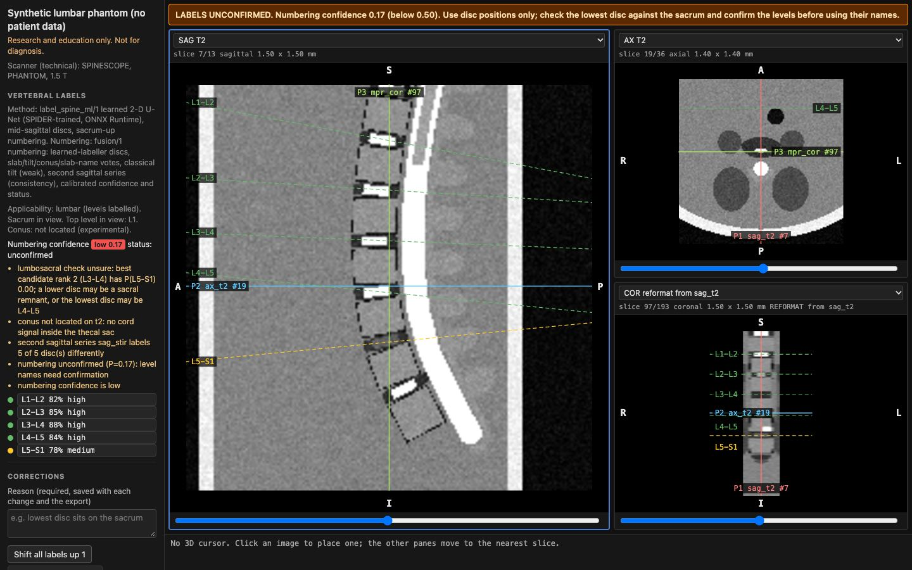
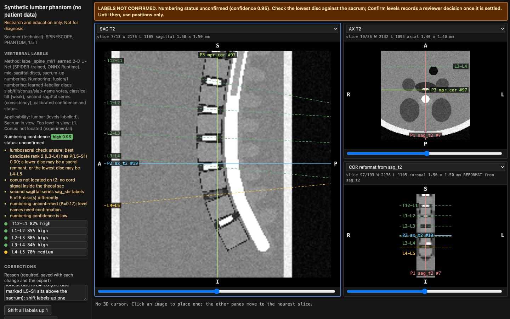
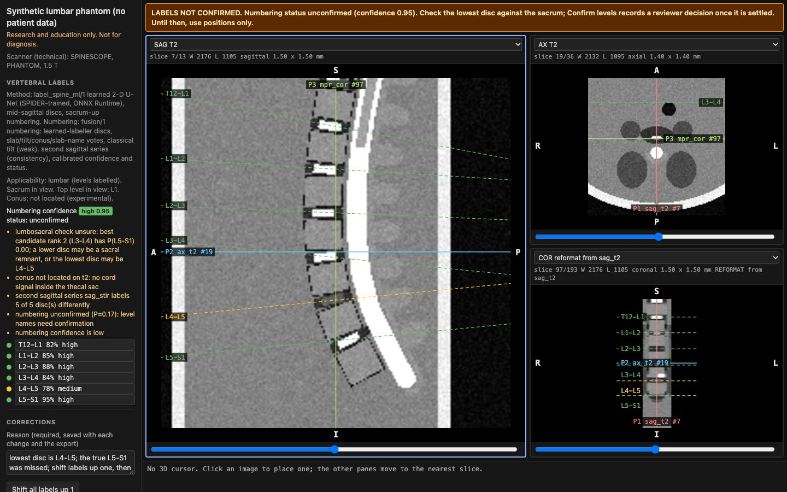
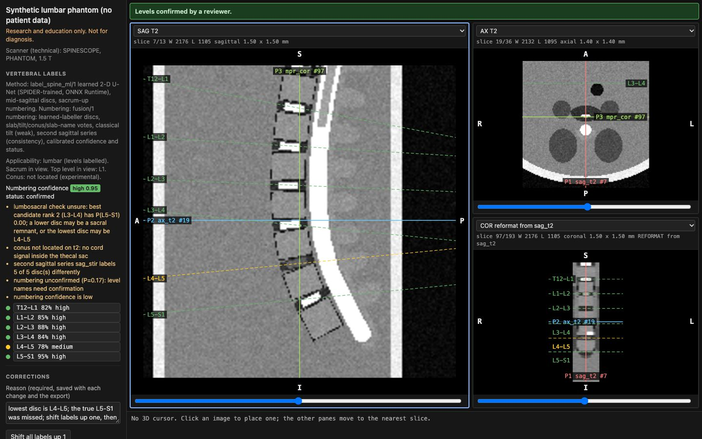

# Correcting the level labels (human review)

The automatic labeller (`spinescope label`) numbers the discs from the sacrum. Its positions are usually right, but the
count from the bottom can be off by one: a sacralized L5 or a lumbarized S1, a missed disc, or an invented one. Only a
person looking at the bone can settle that, so this guide walks through the review: label, correct in the viewer,
check the corrected file, and use it everywhere.

Research use only. Not for diagnosis.

The examples use the synthetic phantom (`spinescope.testing.phantom`). No patient data is involved, and the screenshots
are of the phantom. Real studies work the same way.

## What the status means

Every labelling result has a numbering status, and it decides what may be done with the level names:

| status | meaning | use the names? |
|---|---|---|
| `confirmed` | a human reviewer confirmed the names, the sacrum was in view and the numbering confidence is high | yes |
| `probable` | a human reviewed or corrected the names, but has not confirmed them | yes, marked "to be confirmed" |
| `unconfirmed` | automatic only, or an AI reader relabelled them and no human has looked since, or the bone is not in view | no, positions only |

Two rules are enforced in code (`spinescope.anatomy.review`), not left to the page:

* An AI reader can never confirm the names. Its relabelling is `unconfirmed` until a human reviews it.
* `confirmed` needs an explicit human **Confirm levels** after the last change, and the sacrum must be in the field of
  view. If the sacrum is out of view, the viewer refuses to confirm and the file is kept at `unconfirmed`.

The status in a file is never trusted as written. `apply-labels` recomputes it from the provenance (who changed what,
and whether a human confirmed it last).

## Step 1: label the study

```
spinescope label STUDY --out anchors.json
```

`STUDY` is a DICOM folder or a volume file. The output is the anchors JSON. It carries the study fingerprint, a hash of
the sagittal and axial stack geometry (no UIDs, names, dates or paths), so that it can only be used with the study it
was made from.

For the phantom, the lumbar study with a 1.5 mm pixel grid (so the sacrum is in the field of view):

```python
from spinescope.testing.phantom import PhantomSpec, SpinePhantom, write_standard_study

phantom = SpinePhantom(
    PhantomSpec(
        degenerated={"L4-L5": 0.2}, modic1=[("L4-L5", "inf", "L")], herniation={"L5-S1": ("central", 5.0)}
    )
)
write_standard_study(phantom, "/tmp/phantom_study", px=1.5)
```

Then `spinescope label /tmp/phantom_study --out anchors.json`. The labeller reports `unconfirmed` (its own confidence is
0.17) and calls the lowest disc L5-S1. The phantom's ground truth says that disc is L4-L5, and the true L5-S1 was missed.

## Step 2: open the labelled viewer

```
spinescope viewer /tmp/phantom_study /tmp/phantom_viewer --anchors anchors.json --title "Synthetic lumbar phantom (no patient data)"
```

Open `/tmp/phantom_viewer/spinescope_viewer.html` in a browser. It works offline. The page title is the one you pass, so
keep it free of patient information.



The left column has the vertebral labels (the disc list with confidences), then the **Corrections** block. The lines on
the images are the disc positions. The banner at the top says what may be used.

## Step 3: correct the labels

Every change needs a reason first: type it into **Reason** (up to 200 characters). The reason is saved with each change
and with the export. A change without a reason is refused.

* **Shift all labels up 1** (or down 1). Every level moves one step. Use it when the whole count is off by one, for
  example when the disc marked L5-S1 is really L4-L5. The phantom needs this, and the screenshot below shows the result.

  

* **Rename disc**. Give one disc a new name, for example L5-S1 to L5-L6 for a lumbarized S1 (only that disc moves).
* **Delete disc**. Remove a disc that is not a disc (a false positive, or a thin interval).
* **Place** (add a missed disc). Type the level (the true name), press **Place**, then click the disc centre on a
  sagittal pane. The disc gets the height of the others and the normal of the nearest disc. The phantom's missed L5-S1
  is placed this way.

  

* **Undo** removes the last change (Ctrl/Cmd+Z).

Check the lowest disc against the sacrum on the sagittal and coronal panes before you go on. The sacrum zoom in the
review packet (`spinescope verify-labels`) helps when the sacrum is faint.

The corrections are applied to a copy. A change the viewer cannot make (for example a shift that would leave the S1..T1
range) is refused with a message, and nothing changes.

## Step 4: confirm and export

When the names are right, press **Confirm levels**. The banner changes to "Levels confirmed by a reviewer." The status
still needs the checks in Step 5. Confirm is refused, with the reason shown, when the sacrum is not in view.



Press **Export JSON**. The browser downloads `spinescope_anchors.json`. It holds the corrected labels and the full
provenance list (action, source, who, why, when, what changed, and the labels after each step).

## Step 5: check the corrected file against the study

```
spinescope apply-labels /tmp/phantom_study spinescope_anchors.json --out reviewed.json --who "Reviewer A"
```

`apply-labels` does the following, and refuses the file if a check fails:

1. **Schema.** The file must match `src/spinescope/data/anchors.schema.json`. Unknown keys are refused.
2. **Study binding.** The fingerprint must match the study. A file made from another study (or with no fingerprint) is
   refused with "belong to a different study" or "not bound to a study".
3. **No paths or identifiers.** The file must not contain the study's path or path-shaped text. The reason must not
   carry a path either.
4. **Provenance.** It adds an `apply` record (source human, the reviewer's name, the reason). If you omit `--why`, the
   reason saved in the file is used. With neither, the file is refused.
5. **Status.** It sets the numbering status by the policy above and writes `reviewed.json` (`--out`). Without `--out`
   it prints the table only.

Typical output for the phantom review: the names `T12-L1`..`L5-S1`, status `confirmed`, and a `confirm` record from a
human. The labeller's warnings about the automatic status are replaced by a line that states the review result.

To label and apply in one step, `spinescope label STUDY --anchors spinescope_anchors.json --out reviewed.json` does the
same check. The `--why` and `--who` options work the same way.

## Step 6: use the reviewed labels

Everything downstream reads the reviewed file when you give it:

```
spinescope brief   /tmp/phantom_study --anchors reviewed.json --out brief.md
spinescope tasks   /tmp/phantom_study --anchors reviewed.json --outdir tasks/
spinescope viewer  /tmp/phantom_study /tmp/reviewed_viewer --anchors reviewed.json
```

In Python, the same check is `load_anchors_file(study, "reviewed.json")` from `spinescope.anatomy.review`. It returns
`Anchors` with the status by policy, and the analysis modules, `level_map` and `level_slices` take it as they are.

The MCP server takes the same file: `open_study(path, anchors_path="reviewed.json")` uses the reviewed names for
`get_anchors`, `level_slices`, the renders and the reading briefs.

## If something is refused

| message | what to do |
|---|---|
| `belong to a different study (the stack geometry does not match)` | You are reviewing a different study. Label this study and correct that file. |
| `not bound to a study (no study_fingerprint)` | The file came from an older spinescope version. Label the study again. |
| `does not match the anchors schema` | The file was edited by hand or by another tool. Export it again from the viewer. |
| `a text field contains the study's file name or path` or `looks like a file path` | Remove the path from the reason or the notes. The file is not written. |
| `a reason is needed for the review` | Give `--why`, or export from the viewer with a reason. |
| `the levels cannot be confirmed: ... sacrum not in the field of view` (viewer) | The names stay unconfirmed on this study. Label a study whose field of view includes the sacrum to reach `confirmed`. |

## Limits

* The reviewed status is only as good as the reviewer's reading of the bone. The software enforces the rules
  above; it does not check the anatomy.
* A placed disc takes the reviewer's click as its centre. Its confidence is the human review level, not a measurement.
* Only the labels change. Measurements in the analysis modules are made on the reviewed levels; re-run them after a
  review.

## Files

* `src/spinescope/anatomy/review.py` (the checks, the fingerprint, the status policy)
* `src/spinescope/viewer/assets/labels.js` (the viewer's correction logic, mirrored by `Anchors`)
* `src/spinescope/cli.py` (`label --anchors`, `apply-labels`)
* `tests/test_labeling_review.py` (the end-to-end test on the phantom, and the refusal cases)
