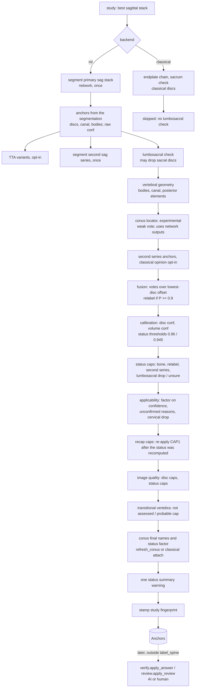

# The labelling pipeline as it runs today

This is the first document to read before changing anything in `src/spinescope/anatomy/`. It describes what
`label_spine(study)` does, in order, on the default path (learned labeller, `backend="auto"`), and where the numbering
status can change. The classical path differences are at the end. The numbers quoted are the shipped ones
(`calibration_v2.json`, `lumbosacral_v1.json`); the per-stage reports are in `docs/labeling/lab*.md`.

Entry points: `label_spine` (returns `Anchors`) and `label_spine_details` (also returns the fusion record and the
calibration features), both in `pipeline.py`. Shared data model: `anchors.py`. Public signatures are unchanged by
this document.

## 1. The status, in one paragraph

`anchors.numbering["status"]` is one of `confirmed`, `probable`, `unconfirmed`. Its meaning is "how far the level
names may be used" (`summary.ABSTAIN_POLICY`). The labeller decides it from a calibrated probability that the whole
numbering is right, then only ever **lowers** it through caps: no bone below the lowest disc, a relabelling, a
second series that disagrees, a sacral disc removed, an unsure lumbosacral check, an unfollowable applicability
check, image-quality flags, a suspected transitional vertebra. A reviewer (human or AI) can also change it, but
only after `label_spine`, through `verify.py` and `review.py` (section 5).

The rules, as the code enforces them:

* **Automatic `confirmed`** needs a calibrated probability at or above the shipped confirmed threshold (0.96), bone
  below the lowest disc (`sacrum_below`), no relabelling, no extra disc below in the second series, a lumbosacral
  check that is not `drop` or `unsure`, no image-quality cap, no suspected transitional vertebra, and no applicability
  reason to be unconfirmed.
* **Automatic `probable`**: calibrated probability at or above 0.945 (and below 0.96), or a `confirmed` that one of
  the caps above lowered.
* **Automatic `unconfirmed`**: below 0.945, or an applicability reason (no sacrum in view, a body too long for one
  body, two discs too close), or a lumbosacral check `unsure` on a probable status, or a quality score below 0.3.
* **AI reader**: never confirms; its answer lowers trust only (section 5).
* **Human reviewer**: `confirmed` only with an explicit confirm after the last change (section 5).

## 2. Diagram

## 3. Stage table (default path, `backend="ml"`)

"Status" means the numbering status; "conf" the numbering confidence (`numbering["confidence"]`) or the disc confidence.

| # | Stage (function, file) | Reads | Writes on `Anchors` | Changes status / conf? |
|---|---|---|---|---|
| 0 | Load only the labelled stacks (`load_labelling_study`, `labelling_keys`) | study | nothing | no |
| 1 | Backend choice (`label_spine_details`): `auto` is ml if ONNX Runtime and the packaged model are present | environment | `LabelDetails.backend` | no |
| 2 | Network segmentation, once per study (`ml.label_spine_ml_segmented` -> `ml.labeller.segment_stack`) | primary sag stack | returns the `SegmentedStack` | no |
| 3 | Anchors from the segmentation (`ml/postprocess.anchors_from_segmentation`) | segmentation | discs (raw conf = disc probability), canal, bodies, `numbering` with the labeller's own heuristic conf, bone warnings | sets raw numbering conf; no status |
| 4 | Test-time augmentation, opt-in (`ml/tta.analyse`, `Config.ml_tta`) | segmentation | `LabelDetails.tta`; evidence line per disc; tta record in numbering after finalise | only through the TTA calibration, which is not shipped (v2 is used, with a warning) |
| 5 | Second sagittal series, once (`pipeline._segmentations`) | second sag stack | segmentation cache (`segs`) | no |
| 6 | Lumbosacral check (`lumbosacral.decide`, packaged CNN) | segmentation, primary discs | removes sacral discs (`drop_lowest`); `numbering["lumbosacral"]`; warnings | `drop` / `unsure` feed the caps in stage 12 |
| 7 | Vertebral geometry (`vertebrae.measure_geometry`) | segmentation | `vertebrae[*].body`, canal, posterior elements; warning on failure | no |
| 8 | S1 signals (`_s1_signals`) | geometry | nothing (feeds `sacrum_below` and calibration) | sets `sacrum_below` |
| 9 | Conus, first pass (`conus.attach_conus`, experimental) | segmentation, cache for the cross-contrast | `anchors.conus` (raw confidence, level before fusion) | no (refreshed in stage 17) |
| 10 | Second-series anchors and classical opinion (opt-in) | second segmentation; classical labeller if enabled | `second`, `classical` records | a disagreeing second series is a cap (stage 12) |
| 11 | Numbering fusion (`fusion.fuse_numbering`, `numbering_checks`) | discs, slab names, tilt, conus, second series, classical | `numbering` votes, offset posterior; `relabel_anchors` shifts names when applied (P >= 0.9) | `relabelled` is a cap (stage 12) |
| 12 | Calibration and status (`_finalise`: `calibration.load_calibration`, `numbering_status`, `_apply_status_caps`) | fusion, signals, features | disc confidence = calibrated; `numbering` = status, confidence, confidence_raw, calibrated, sacrum_below, notes, second_series, lumbosacral, tta | **sets status** (thresholds 0.96 / 0.945, or 0.9 / 0.6 uncalibrated); caps here |
| 13 | Applicability (`ood.assess_applicability`, `ood.apply_applicability`) | study metadata, discs, segmentation, FOV | `applicability` record; drops cervical discs; disc and numbering conf x factor; thoracic cap; status recomputed from conf; `unconfirmed_reasons` | **can set status**: recomputed from the conf (can only lower, since the factor is at most 1); a not-labelled study is cleared to `unconfirmed`, conf 0 |
| 14 | Recap of the caps (`_recap_status`) | numbering record | status re-capped; one line "numbering capped to X after applicability" | **lowers status** back to the caps that stage 13 may have undone |
| 15 | Image quality (`artifacts.assess_quality`, `apply_quality`) | study pixels, discs | `quality` record; discs of flagged levels capped at `quality_disc_cap` (0.5, motion ghosting only); warnings | **lowers status**: confirmed to probable on a flagged level; below 0.3 score to unconfirmed |
| 16 | Transitional vertebra (`lstv.attach_lstv`, `pipeline._lstv_stage`) | anchors, status | `lstv` record; one warning when suspected | **lowers status**: unassessed when unconfirmed; confirmed to probable when suspected. Never renames |
| 17 | Conus final names (`conus.refresh_conus` on ml; `_conus_after_labels` on classical) | conus raw tip z, final status | conus level, position, low-lying flag, confidence x status factor (1.0 / 0.9 / 0.7), capped at 0.5; evidence "level names: numbering X" | no (reads the final status) |
| 18 | Status summary (`pipeline._status_warnings`) | final status, conf | the only status sentence: "numbering X (P=..): level names need confirmation", "numbering confidence is low" | no |
| 19 | Study binding (`review.stamp_study`) | study geometry | `numbering["study_fingerprint"]` | no |

Stage 12 writes `numbering` as a fresh dict (keeping only the `midline_*` keys). Keys that the segmentation wrote and
the schema does not allow (`sacrum_confirmed`, `sacrum_evidence`, `fov_below_lowest_disc_mm`) are therefore not in the
`label_spine` output; `label_spine_ml` returns them. This is intended: the output must match the schema.

## 4. Every place that changes the status or the confidence

| Where (file: function) | What it does | Direction |
|---|---|---|
| `pipeline._finalise` | sets status from calibrated conf and thresholds; no discs gives `unconfirmed` | sets |
| `pipeline._apply_status_caps` (called from `_finalise` and `_recap_status`) | confirmed to probable (bone, relabel, second series, lumbosacral drop); probable or confirmed to unconfirmed (lumbosacral unsure) | lowers |
| `pipeline._finalise` (calibration) | disc confidence replaced by the calibrated probability; uncalibrated keeps raw | sets (disc) |
| `ood.apply_applicability` | confidence x factor (at most 1); status recomputed from it; `unconfirmed` for unconfirmed reasons; not labelled gives `unconfirmed` and conf 0 | lowers |
| `pipeline._recap_status` | re-applies the stage-12 caps | lowers |
| `artifacts.apply_quality` | disc caps for flagged levels; status caps | lowers |
| `pipeline._lstv_stage` | status cap on suspected transitional vertebra (after assessing it when unconfirmed) | lowers |
| `verify.apply_answer` (after labelling) | AI: confidence min(prior, 0.85), status at most probable, min with the prior status, unconfirmed on relabel or unsure. Human: at most probable, confidence 0.95 | lowers for AI; probable for human |
| `review.reconcile_status` / `apply_review` (after labelling, on import) | status recomputed from provenance; the file's word is not trusted | sets (see section 5) |
| `anchors.record_correction(confidence=...)` and the Anchors correction methods | a programmatic `confidence` argument sets `numbering["confidence"]`; they never set the status | sets conf only, by the caller |

Nothing in the conus, the counting, the scoliosis, the correspondence or the summary modules changes the status.
The viewer shows the status and the review actions; the confirm record it writes is read by `review.py`.

## 5. Human and AI review (after `label_spine`)

Policy, as the code and `docs/guide/correcting-labels.md` state it:

| Event | Status |
|---|---|
| AI reader answers (no relabel, no unsure) | at most `probable`; never raised above the prior status; `unconfirmed` if the prior is missing or unconfirmed |
| AI reader relabels the names | `unconfirmed` until a human has looked (`review._provenance`: `ai_pending`) |
| AI reader says unsure | `unconfirmed` |
| Human answers the verification packet, or applies a corrected file | `probable` at most. No confirm record, so no `confirmed` |
| Human confirm (viewer "Confirm levels", a `confirm` record from a human) after the last change | `confirmed` if the confidence is at or above 0.9 (see open decision 1), otherwise `probable` |
| Applicability says unconfirmed (no sacrum in view, and so on) | `unconfirmed` whatever the review says |

An AI reader's answer therefore cannot raise trust, and only a human `confirm` record reaches `confirmed`.

## 6. Open decisions for the coordinator

1. **Human confirm threshold.** `review.reconcile_status` gates a human confirm with `DEFAULT_STATUS_THRESHOLDS`
   (0.9), but the labeller's automatic `confirmed` uses the shipped calibration (0.96). A human can therefore confirm
   a numbering with confidence 0.90 to 0.96, which the calibrated labeller would call `probable`. Left unchanged: the
   review tests and `Config.review_confidence_human` (0.95, written on a human confirm) are built on the default
   gate, and the documented rule in `review.py` says so. Decide whether a human confirm should use the calibrated gate.
2. **Human answer to the verification packet.** Changed in lab37: it used to set `confirmed` directly. It is now at
   most `probable`, the same as a human correction without a confirm. The guide says a confirm needs the explicit
   action, and the import (`review.reconcile_status`) already downgraded such files to `probable`.
3. **Unused public config fields.** `sac_area_relative_mm2`, `sac_area_absolute_mm2` and `conus_slice_halfwidth_mm`
   are read by no module. They are kept (public) and marked deprecated in `config.py`.

## 7. Classical path (`backend="classical"`, or `auto` without ONNX Runtime)

`_label_classical`: endplate chain on the best sagittal stack (`_analyse_stack`), numbering from the sacrum check
(`numbering.sacrum_check`). `_finalise(kind="classical")` then runs the same fusion, caps and applicability with these
differences: no lumbosacral check, no vertebral geometry, no calibration (default thresholds, `calibrated: false`),
`sacrum_below` is `confidence >= 0.8` of the sacrum check, and the conus locator runs after the labels are final
(`_conus_after_labels`). That locator still runs the network on the primary stack, so the classical path needs the
package's ONNX model for the conus. The coronal alignment is recorded as not measured.

## 8. Failure rules

* A stage that is additional (second series, classical opinion, geometry, conus, quality, transitional vertebra,
  TTA, counting) is wrapped: a failure adds a warning and leaves the labels and status as they were.
* Stages on the labelling path (segmentation, anchors, fusion, calibration, applicability, recap) are not wrapped.
  `label_spine` raises only for an unknown backend name. Odd inputs (one or two slices, all-zero, constant, NaN,
  tiny matrices, noise, uint16 saturation) were checked with synthetic stacks in lab37 and return an anchors object.
* The status summary, the caps and the conus derivation are the only places that write the status sentence.

## 9. Determinism and repeated work

* No random numbers in the pipeline. ONNX sessions are cached per path and thread setting
  (`ml/labeller._SESSIONS`); the lumbosacral and calibration loaders are cached.
* Each sagittal stack is segmented at most once per `label_spine` call: the primary in stage 2, the second series in
  stage 5, and the conus cross-contrast check reuses either (lab37 fix: it used to run the network again).
* Image-quality ghosting computes its lag correlations without `np.corrcoef` (same Pearson r; lab37).
* Per-study latency (single process, 10 SPIDER validation cases, T1 and T2 each): see the measured figures in
  the lab37 integration notes at the end of this file.

## 10. Where the tests are

`tests/test_labeling_lab22.py` (stage order and single segmentation on the phantom),
`tests/test_labeling_integration.py` (the lab37 regressions: caps, status summary, review policy, segmentation count,
ghosting correlation), `tests/test_labeling_review.py` and `tests/test_labelling_surfaces.py` (review and status
policy), `tests/test_labeling_redteam.py` (adversarial inputs).

## 11. lab37 integration notes (what changed, and the numbers)

Changes, all on the default path unless marked:

* Human answer to the verification packet: at most `probable` (was `confirmed`). Test: `test_labelling_surfaces.py::test_review_status_rules`, `test_labeling_integration.py::test_human_answer_is_probable_never_confirmed`.
* AI answer on anchors with no status or no confidence: unconfirmed, confidence 0 (was probable). Test: `test_ai_answer_cannot_raise_a_missing_status`.
* One status summary, written last from the final status (was one sentence per stage, which could contradict the final status). The labeller's bone warnings now state the cause only ("lowest disc not confirmed by bone: ..."). Test: `test_one_status_summary_matching_the_final_status`.
* Conus derived after the image-quality and transitional-vertebra caps (was before), so its status factor and evidence match the final status. Test: `test_conus_is_derived_after_every_status_cap`, `test_conus_status_factor_matches_the_final_status`.
* Suspected transitional vertebra: the message is picked by its text (it was the first warning, which is the kind note when the kind is unresolved). Test: `test_suspected_transitional_message_is_kept_when_the_kind_is_unresolved`.
* Repeated work: the second sagittal series was run through the network twice when it was also the conus cross-contrast check. Now once. Test: `test_second_series_is_segmented_once_when_it_is_also_the_conus_contrast`.
* Repeated work: disc geometry computed once per disc in the classical numbering (was twice).
* Performance: the motion-ghosting lag correlation (image quality) uses a direct Pearson r rather than `np.corrcoef`. Same values (test `test_pearson_matches_numpy_corrcoef`); about 2x faster for that stage.
* Opt-in test-time augmentation: an exception is now a warning, not a failure of `label_spine`.
* Dead code removed: an empty branch in `_analyse_stack`, an unused variable in `_vertebrae`.
* Docs: the stage docstrings, `config.py` comments (`viewer_conf_low` said the pipeline used 0.5 for "numbering confidence is low", which it did not; `sac_area_*` and `conus_slice_halfwidth_mm` are unused and marked deprecated; the fields stay because they are public).

Output changes on SPIDER validation (10 cases, `label_spine`): numbers, names, statuses, conus and confidences are identical
to main. Only the wording and the order of warnings change. Benchmark `--check` against `benchmarks/golden.json`: PASS, all
81 golden metrics identical.

Latency, `label_spine` only (volume reads excluded), first 10 SPIDER validation studies, one process, default ONNX
threads. Measured on a laptop shared with other agents (load average 30 to 80), so the wall times are noisy; the CPU
times and the ratio are the reliable part:

| run | total wall (10 studies) | median wall | total CPU |
|---|---|---|---|
| main, quiet machine (earlier run) | 64.5 s | 2.71 s | not measured |
| lab37, quiet machine (earlier run, before the TTA guard and the cosmetic edits) | 39.6 s | 1.76 s | not measured |
| main, loaded (two runs) | 77.0 s, 93.6 s | 4.69 s, 6.52 s | 180 s, 195 s |
| lab37, loaded (two runs) | 66.2 s, 63.4 s | 3.35 s, 4.17 s | 141 s, 137 s |

Remaining per-study cost is network inference (about 0.6 to 3.5 s per segmentation, one or two per study) and, on the
slowest study, the image-quality ghosting detector (about 4 s before the change, about half of that after it).

Remaining risks and open items (see section 6 for the decisions):

* The human confirm gate uses the default threshold (0.9), not the calibrated `confirmed` threshold (0.96).
* `sacrum_confirmed`, `sacrum_evidence` and `fov_below_lowest_disc_mm` are written by the segmentation postprocess and
  dropped by the pipeline (the schema does not allow them). Only `label_spine_ml` returns them.
* `conus` is experimental; its tip is a weak fusion vote on the learned path, and it is located from the same network output.
